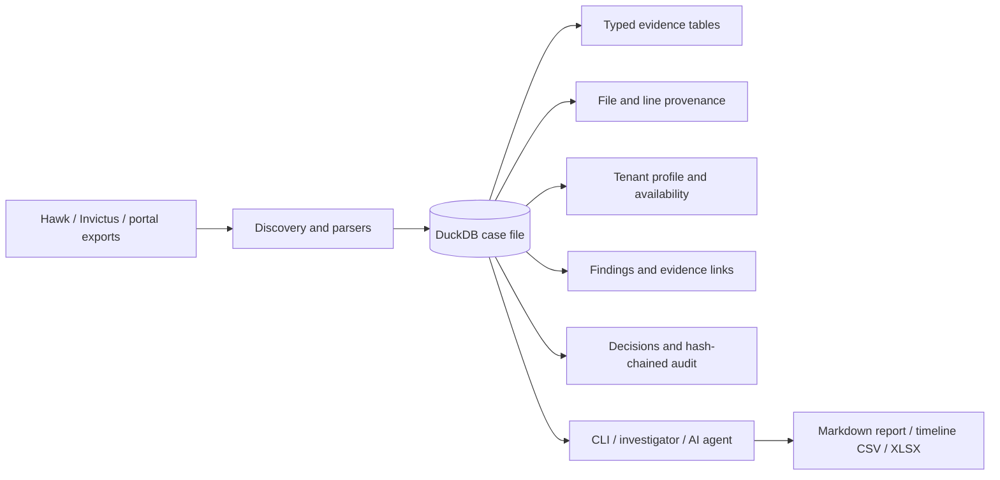
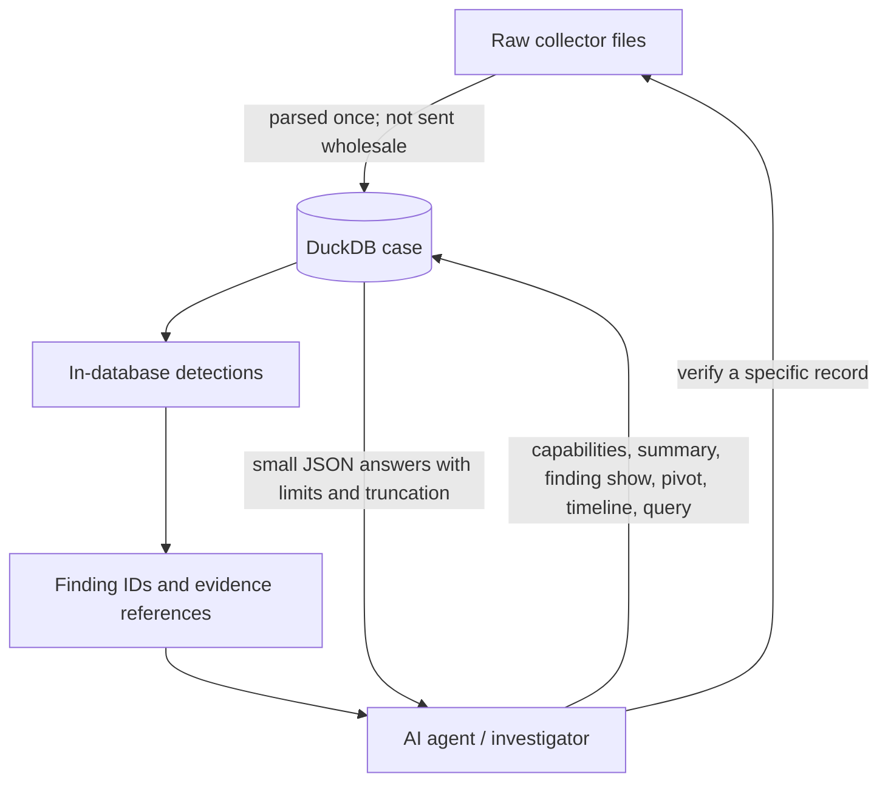

# Sparrow

Sparrow turns Microsoft 365 evidence for a business-email-compromise investigation into one queryable DuckDB case file. It ingests Hawk 3.x/4.x, Microsoft-Extractor-Suite (Invictus), and portal exports; keeps the original file and line provenance of each record; profiles the tenant and its evidence gaps; runs 34 detection rules; and gives an investigator a CLI for findings, timelines, indicators, notes, audited decisions, and exports.

One case can contain multiple collections and tenants. Sparrow does not collect evidence from Microsoft 365 itself: give it collector output you are authorized to examine. Its local CLI needs no network connection at runtime.

For the full collector/artifact map, profile tables, detection semantics, and synthetic-data reference, see [Reference](docs/REFERENCE.md).



## Requirements

- A supported Rust toolchain (Rust 1.85.1 or newer), Cargo, and a C/C++ compiler to build the bundled DuckDB. The first build compiles DuckDB and can take several minutes.
- macOS, Linux, or Windows with enough free disk space for the collector tree, the case file, and the build output. Memory and disk needs depend on the evidence volume; leave headroom for DuckDB's working data and exports. No customer-data sizing claim is implied here.
- Optional MaxMind GeoLite2 City and ASN `.mmdb` files in one directory, passed with `--geoip-dir DIR`. Without them there is no geolocation, and rules requiring GeoIP report `not_applicable` rather than silently returning no hits.

## Try it with synthetic evidence

These commands use Sparrow's deterministic `bec-aitm` scenario, not customer data. From the repository root:

```bash
cargo build -p sparrow-cli
./target/debug/sparrow synth --scenario bec-aitm --collector hawk4 --out tree
./target/debug/sparrow ingest tree --case case.duckdb
./target/debug/sparrow capabilities --case case.duckdb --json
./target/debug/sparrow summary --case case.duckdb --json
./target/debug/sparrow finding list --case case.duckdb --json
./target/debug/sparrow export report --format md --out report.md --case case.duckdb
```

`ingest` profiles the case and runs detection automatically. Start with `capabilities`: it says which evidence is present, incomplete, unavailable, or beyond retention and why. Then use `summary` for the tenant, collections, coverage window, top actors, and gaps. Use the returned finding IDs with `finding show` before deciding what to do. The synthetic tree contains a ground-truth manifest; `sparrow synth check --manifest tree/manifest.json --case case.duckdb` compares the ingested case and detection results with it.

For a release build, use `cargo build --release -p sparrow-cli` and run `./target/release/sparrow`. All examples below assume `sparrow` is on your `PATH`; substitute `./target/debug/sparrow` if it is not.

## From collector output to a case

```bash
sparrow discover /evidence
sparrow ingest /evidence --case case.duckdb
sparrow ingest /evidence --case case.duckdb --culture en-GB --geoip-dir /geoip
sparrow profile --case case.duckdb --geoip-dir /geoip
sparrow upgrade --case case.duckdb
```

`discover` previews the collections and file classifications. `ingest` accepts a collector output root or a folder of recognized portal exports; it records unsupported artifacts and per-file or per-record errors instead of hiding them. For ambiguous culture-formatted dates, specify `--culture` on ingest. Use `profile` to refresh tenant identity, capabilities, IP enrichment, and the unified timeline after changing evidence or optional data. `upgrade` brings an older case to the current schema; a failed post-migration rebuild is retried on the next writable open. Read commands warn while it remains pending.

Hawk 3.x/4.x, Invictus 4.x, and portal exports can be combined in one case. Sparrow deduplicates repeated events, keeps every source sighting in `record_sources`, and merges state from newer collections. Evidence rows retain source references so you can re-check them later. Custom definitions can be supplied with `--data DIR` and repeatable `--rules DIR` (or `SPARROW_DATA` and `SPARROW_RULES`); see [rule authoring](rules/README.md).

## See what the evidence can support

```bash
sparrow capabilities --case case.duckdb --json
sparrow summary --case case.duckdb --json
sparrow schema --case case.duckdb --table signins
sparrow verify ual_events RECORD_KEY --case case.duckdb
```

Availability distinguishes evidence that was collected, partial, not licensed, not enabled, outside retention, available but not collected, or unknown. Its reason and suggested collector command help you avoid treating a gap as a clean result. `verify` checks a record against its original file and location; if the evidence tree moved, pass `--root NEW_COLLECTION_ROOT`. `schema` describes the tables and views `query` can read, with each column's type and description (`--table` for one).

## Triage detections and investigate events

Detection runs after ingest and profile, or on demand:

```bash
sparrow detect --case case.duckdb
sparrow detect --case case.duckdb --rule SPW-MAIL-003
sparrow finding list --case case.duckdb --severity high --json
sparrow finding list --case case.duckdb --user user@contoso.example --rule SPW-ID-004 --rule SPW-MAIL-003 --limit 20 --json
sparrow finding show FINDING_ID --case case.duckdb --json
sparrow finding show FINDING_ID OTHER_ID --case case.duckdb --json
sparrow timeline --case case.duckdb --finding FINDING_ID --limit 50 --json
sparrow pivot ip 203.0.113.2 --case case.duckdb --cap 20 --json
sparrow pivot user analyst@contoso.example --case case.duckdb --cap 20 --json
```

The 34 rules run per tenant. Each rule attempt is recorded as `ran`, `not_applicable` with a reason, or `error`; a missing capability, unavailable evidence, or absent GeoIP is not silently counted as a negative. Findings retain their evidence across re-runs, and re-running detection never overwrites an analyst's status, assignment, or disposition. `finding list` filters combine: `--severity` is a minimum, `--rule` repeats, `--user` ignores case, and `--limit` reports what it left out. `finding show` includes guidance, evidence references, notes, and decision history (`--all` removes the default 50-evidence-row cap in plain output; JSON already includes all evidence); it takes up to 50 ids at once and lists the unknown ones (exit 2). `timeline` filters by user, IP, category, time, or finding. `pivot` returns capped sections about one IP or user and reports truncation. Use `--limit` or `--cap` deliberately when sending results to an agent.

For a targeted read-only SQL question:

```bash
sparrow query "SELECT category, count(*) AS events FROM timeline GROUP BY category" --case case.duckdb --limit 20 --json
```

`query` accepts one `SELECT` or `WITH … SELECT`, caps returned rows (default 1,000), and runs on a locked-down, read-only connection with no external file, network, or environment access. It cannot change case data or settings. An invalid or forbidden query exits 1. It can see all case tables, including `case_meta`; do not treat its output as a tenant-scoped view unless your SQL filters by tenant.

## Why one DuckDB case helps an AI agent

Collector trees can contain many large CSV and JSON files. Sparrow parses them once into typed, related evidence tables. Detection runs in the case and gives the agent findings with evidence references, so it can ask a sequence of small questions instead of repeatedly loading raw files. `capabilities`, `summary`, `finding list`, `pivot`, `timeline --limit`, and `query --limit` have compact `--json` output; capped results report truncation. `verify` takes the agent back to the original file and line when a conclusion needs checking.



This reduces the amount of evidence text an agent needs to receive, but the savings depend on the case and the questions asked. No token or byte reduction is claimed here; none was measured for this README.

**Agent skills.** [`skills/`](skills/README.md) holds two portable [Agent Skills](https://agentskills.io/specification), a tool-neutral M365 BEC triage playbook and a `sparrow` workflow, that work unchanged in Claude Code, Codex, OpenCode and Pi. See [skills/README.md](skills/README.md) to install them.

## Agent workflow: record decisions, then review them

Every CLI write is an **agent decision**, even when a person typed the command. Pass `--agent ID` (or set `SPARROW_AGENT`; default `unnamed`) and optionally `--analyst NAME` (or `SPARROW_ANALYST`) on finding, IOC, timeline-entry, and note writes:

```bash
sparrow finding set-status FINDING_ID confirmed --reason "evidence reviewed" --case case.duckdb --agent triage --analyst reviewer
sparrow finding assign FINDING_ID reviewer --case case.duckdb --agent triage --analyst reviewer
sparrow ioc add --case case.duckdb --type ip --value 203.0.113.2 --verdict suspicious --note "investigate" --agent triage --analyst reviewer
sparrow timeline-entry propose --time 2026-08-21T09:47:00Z --title "Inbox rule created" --phase persistence --evidence ual_events:RECORD_KEY --case case.duckdb --agent triage --analyst reviewer
sparrow note add finding:FINDING_ID --text "Check the original header" --case case.duckdb --agent triage --analyst reviewer
sparrow audit verify --case case.duckdb --json
```

Also available: `finding ack-rule-update`, `ioc set-verdict|remove|list`, `timeline-entry verify|reject|edit|list`, `tenant domains add|remove|list`, and `audit log`. An IOC can be tenant-scoped with `--tenant KEY`; without it, it applies case-wide. Removed IOCs are retained but no longer read by rules. A new decision takes effect immediately and is tagged `pending_review`; `--analyst` names the intended reviewer, not an authenticated identity. **Review itself happens outside the CLI.** The CLI cannot prove who ran it. Exports distinguish unreviewed AI decisions, and `export report --reviewed-only` includes accepted decisions only.

The audit trail is SHA-256 hash-chained. `audit verify` reports the first broken sequence and its head hash; a break blocks writes until `audit verify --acknowledge` records it. Keep the head hash outside the case to detect replacement of the whole case file or a rewrite of its own audit bookkeeping. See [developer notes](docs/DEVELOPING.md) for the precise provenance and review behavior.

## Export deliverables

```bash
sparrow export report --format md --out report.md --case case.duckdb
sparrow export report --format md --reviewed-only --out reviewed.md --case case.duckdb
sparrow export timeline --format csv --scope verified --out timeline.csv --case case.duckdb
sparrow export workbook --format xlsx --out case.xlsx --case case.duckdb
```

Exports read the case without adding an audit entry. The Markdown report is suited to a customer handoff, the UTF-8 Timeline Explorer CSV to spreadsheet analysis, and the XLSX workbook to a fuller case review. Every export includes Sparrow version, rule-pack hash, generation time, audit status and head hash, and decision counts. Times are UTC. Evidence and agent text are escaped or written as inert cells so they cannot turn into Markdown/HTML or spreadsheet formulas. Output files are written atomically; `--out` cannot overwrite the case.

## JSON, limits, and exit codes

Add `--json` to any command for machine-readable output; errors are JSON on stdout in this mode. Plain output escapes control and Unicode format characters in untrusted text. If a post-migration step is pending, read commands warn on stderr and their JSON output carries a top-level `warnings` array.

| Code | Meaning |
| ---: | --- |
| 0 | Success. |
| 1 | Other error, including an invalid option or a refused `query`. |
| 2 | Ingest completed with file/record/reconciliation problems; `verify` mismatch; or a synthetic coverage/conformance gap. |
| 3 | Broken audit chain (`audit verify` or a write it blocks). |
| 4 | Case open by another writer. |
| 5 | Invalid agent decision, or an export path that would overwrite the case. Nothing was written. |

DuckDB permits one writer process for a case file. A reader can also be refused while a writer holds it. If an ingest exits 2, inspect its per-file errors and evidence-availability report; the case may still contain usable evidence.

## For developers

[Reference](docs/REFERENCE.md) retains the detailed collector and table map, profile/enrichment behavior, detection and finding semantics, and synthetic-data guide. [Developer notes](docs/DEVELOPING.md) cover build, test, golden, cache, and safety practices. [Rule authoring](rules/README.md) covers the rule format, inline tests, lists, and custom directories. [Synthetic-data documentation](crates/sparrow-synth/README.md) covers scenarios, manifests, coverage, conformance, and generator options.

## License

Sparrow is licensed under the [MIT License](LICENSE). Copyright (c) 2026 Carlos Perez.
