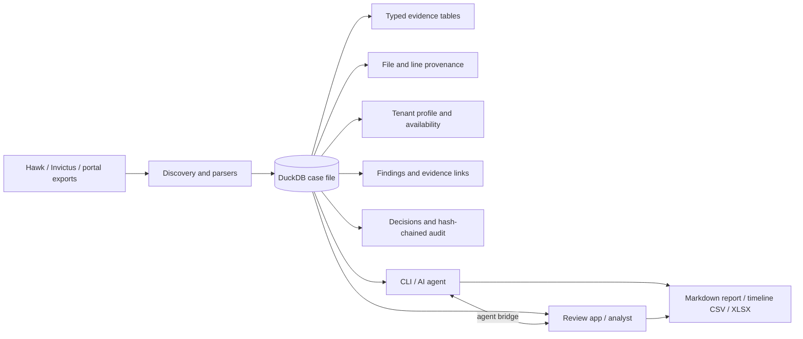
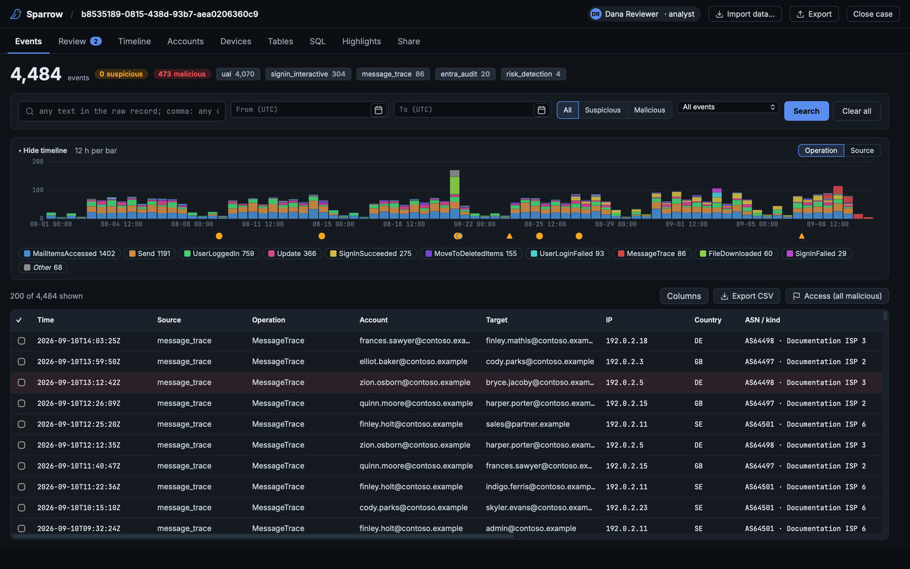
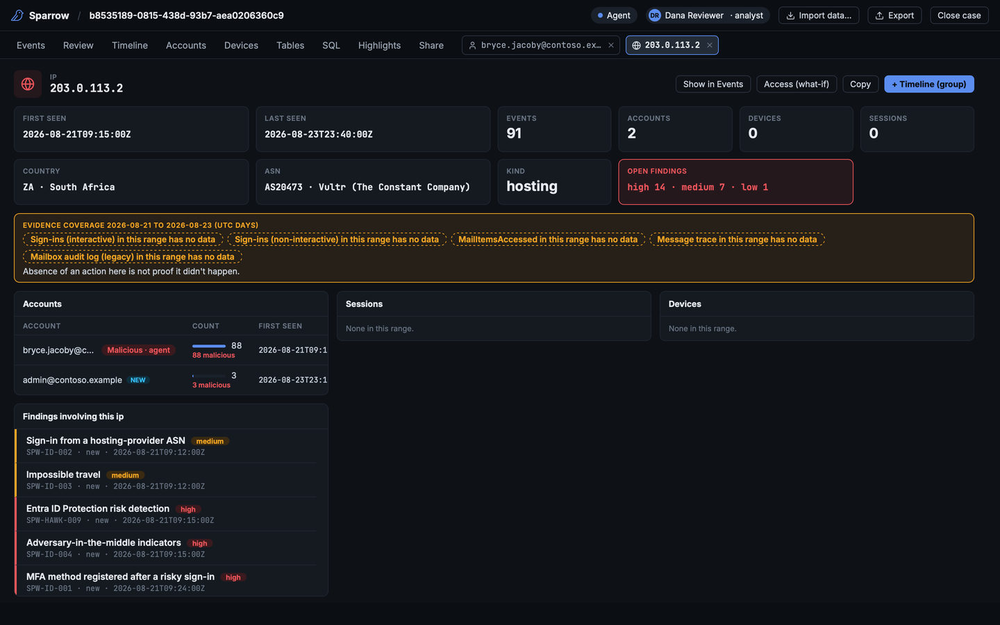
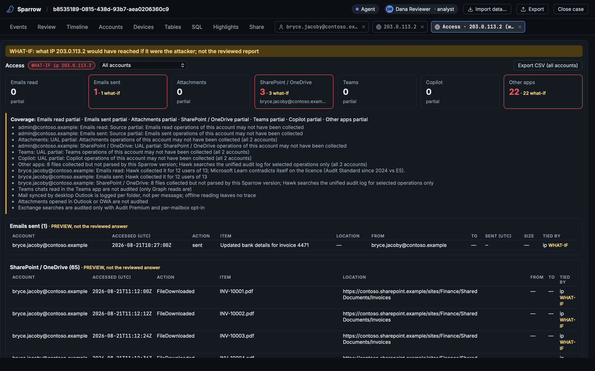
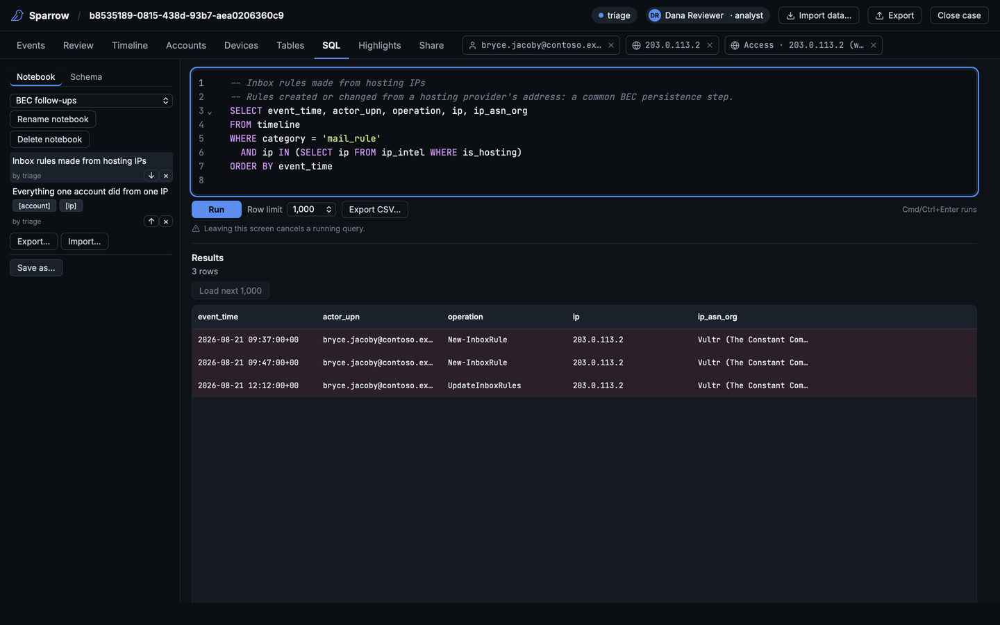
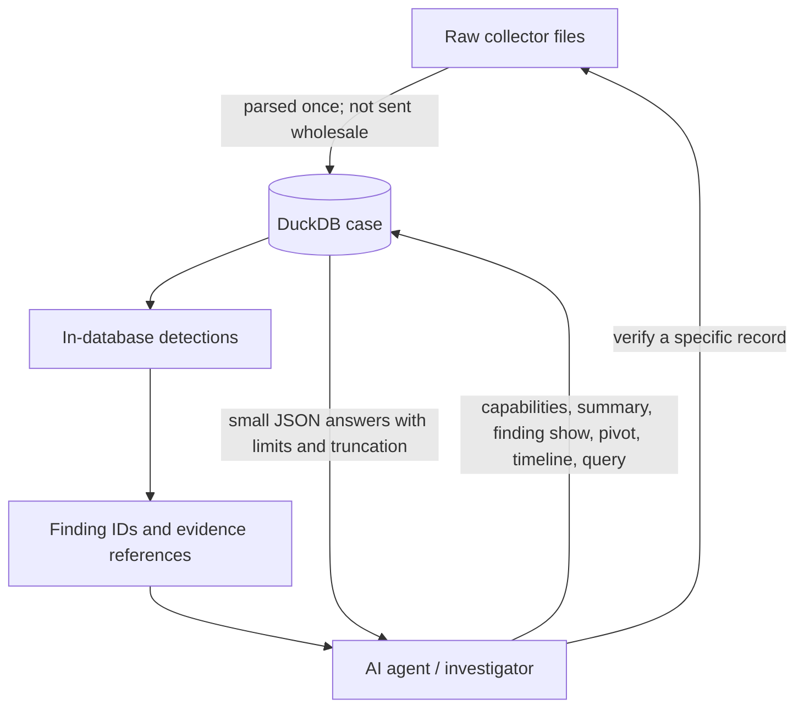
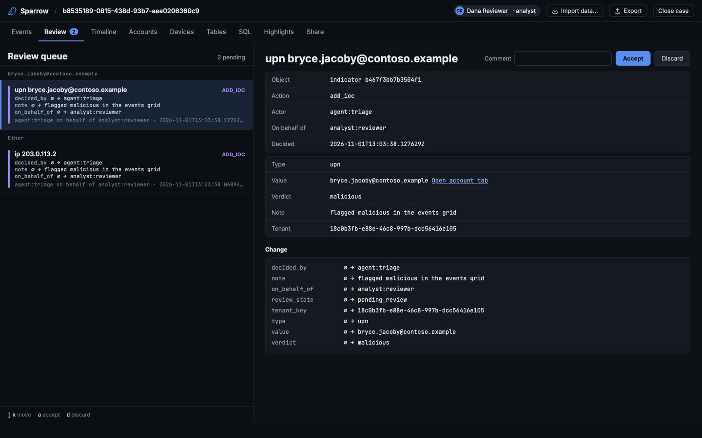

# Sparrow

Sparrow turns Microsoft 365 evidence for a business-email-compromise investigation into one queryable DuckDB case file. It ingests Hawk 3.x/4.x, Microsoft-Extractor-Suite (Invictus), and portal exports; keeps the original file and line provenance of each record; profiles the tenant and its evidence gaps; runs 34 detection rules; and gives an investigator a CLI for findings, timelines, indicators, notes, audited decisions, and exports, plus a desktop review app for working the case on screen.

One case can contain multiple collections and tenants. Sparrow does not collect evidence from Microsoft 365 itself: give it collector output you are authorized to examine. Its local CLI needs no network connection at runtime.

For the full collector/artifact map, profile tables, detection semantics, and synthetic-data reference, see [Reference](docs/REFERENCE.md). Every built-in detection rule is described in [Detection rules](docs/RULES.md).



## Install a release

Test builds are on the [Releases page](https://github.com/darkoperator/Sparrow/releases), and each release's notes give the steps for your platform. Install the app and the CLI from the same release; they refuse to talk to each other across versions. To build from source instead, read on.

## Requirements

- A supported Rust toolchain (Rust 1.85.1 or newer), Cargo, and a C/C++ compiler to build the bundled DuckDB. The first build compiles DuckDB and can take several minutes.
- macOS, Linux, or Windows with enough free disk space for the collector tree, the case file, and the build output. Memory and disk needs depend on the evidence volume; leave headroom for DuckDB's working data and exports. No customer-data sizing claim is implied here.
- Optional MaxMind GeoLite2 City and ASN `.mmdb` files in one directory, passed with `--geoip-dir DIR`. The app reads them from the GeoIP folder chosen in its import dialog, or from `~/geoip` when no folder is chosen and that folder holds both. Without them there is no geolocation, and rules requiring GeoIP report `not_applicable` rather than silently returning no hits.

## Try it with synthetic evidence

These commands use Sparrow's deterministic `bec-aitm` scenario, not customer data. From the repository root:

```bash
cargo build -p sparrow-cli
./target/debug/sparrow synth --scenario bec-aitm --collector hawk4 --out tree
./target/debug/sparrow ingest tree --case case.duckdb
./target/debug/sparrow capabilities --case case.duckdb --json
./target/debug/sparrow summary --case case.duckdb --json
./target/debug/sparrow finding list --case case.duckdb --json
./target/debug/sparrow export report --format md --out report.md --case case.duckdb
```

`ingest` profiles the case and runs detection automatically. Start with `capabilities`: it says which evidence is present, incomplete, unavailable, or beyond retention and why. Then use `summary` for the tenant, collections, coverage window, top actors, and gaps. Use the returned finding IDs with `finding show` before deciding what to do. The synthetic tree contains a ground-truth manifest; `sparrow synth check --manifest tree/manifest.json --case case.duckdb` compares the ingested case and detection results with it.

For a release build, use `cargo build --release -p sparrow-cli` (or `scripts/release.sh --cli`; `scripts/release.sh` alone also builds the review app) and run `./target/release/sparrow`. All examples below assume `sparrow` is on your `PATH`; substitute `./target/debug/sparrow` if it is not.

## The review app

The review app is a desktop app (Tauri) for the analyst. It opens a case file, or builds a new case from a collector folder, and shows the same case the CLI works on. Build it with `scripts/release.sh` (the CLI and the app; `--app` for the app alone). On macOS it produces `target/release/bundle/macos/Sparrow.app`; on Windows, from Git Bash, an installer in `target/release/bundle/nsis/`. See [developer notes](docs/DEVELOPING.md#review-app) for running it from source.



- **Events**: every event record in one grid, with a timeline chart, text search, field filters (`source`, `operation`, `account`, `ip`, `country`, `asn`, `device`, `session`, `tag`, `rule`), a time range, and suspicious/malicious flags. A row opens a detail panel with its flags, tags, and notes.
- **Accounts, IPs, devices and sessions** open in their own tabs: tiles, the evidence coverage for the range, pivot tables, and findings, with links onward.
- **Access** opens from an account tab, from an IP or device tab as a what-if, or from Events for the whole case, and answers "what did the attacker get?", with an Export CSV. Not every item has an app name: the App column falls back to the application id or the client the record names (`Client=OWA;...`), or `—` when the record names none. See [Access report](docs/REFERENCE.md#access-report).
- **Review** is the queue of agent decisions waiting for the analyst. **Timeline** holds the case's investigation timeline entries (proposed, verified, rejected); **Tables** browses any evidence table with filters; **Highlights** colours rows that match the analyst's rules; **Share** exports your work as a bundle for another analyst and imports theirs (preview first, then confirm). The header's **Export** writes the report, the timeline CSV, the workbook, and the access report of the accounts with malicious activity (CSV, or a Markdown summary).
- Every table sorts by a click on a column's header and filters from a right-click on it: its values with counts, or From/To date pickers on a date column (a right-click on a cell in a grid offers the same). Events and Tables filter on the backend; the other tables filter the rows they have loaded.
- **SQL** runs read-only queries, with the built-in and case notebooks beside the editor.







While the app has a case open, `sparrow` commands on the same computer that open that same case run through it (the [agent bridge](docs/REFERENCE.md#agent-bridge)): an agent works on the case the analyst is looking at, without the "case is open by another writer" error, and the analyst's screen refreshes as the agent writes. Commands that hold the case for minutes (`ingest`, `profile`, `detect`, `upgrade`) are refused through the bridge (exit 4): run them with the case closed in the app. `--no-bridge` (or `SPARROW_BRIDGE=off`) opens the file directly instead.

## From collector output to a case

Planning the collection? [What to collect, by licence](docs/COLLECTION.md) lists what each Microsoft 365 licence level makes available, how long it lasts, and which collector command pulls it, starting with what expires first.

```bash
sparrow discover /evidence
sparrow ingest /evidence --case case.duckdb
sparrow ingest /evidence --case case.duckdb --culture en-GB --geoip-dir /geoip
sparrow profile --case case.duckdb --geoip-dir /geoip
sparrow upgrade --case case.duckdb
```

`discover` previews the collections and file classifications. `ingest` accepts a collector output root or a folder of recognized portal exports; it records unsupported artifacts and per-file or per-record errors instead of hiding them. For ambiguous culture-formatted dates, specify `--culture` on ingest. Use `profile` to refresh tenant identity, capabilities, IP enrichment, and the unified timeline after changing evidence or optional data. `upgrade` brings an older case to the current schema; a failed post-migration rebuild is retried on the next writable open. Read commands warn while it remains pending.

Hawk 3.x/4.x, Invictus 4.x, and portal exports can be combined in one case. Sparrow deduplicates repeated events, keeps every source sighting in `record_sources`, and merges state from newer collections. A follow-up pull for one user (mailbox audit log, message trace, MailItemsAccessed) is added the same way: run `sparrow ingest` on its output folder with the same `--case`. See [adding a follow-up pull](docs/REFERENCE.md#adding-a-follow-up-pull-for-one-user) for the file layouts Sparrow expects. Evidence rows retain source references so you can re-check them later. Custom definitions can be supplied with `--data DIR` and repeatable `--rules DIR` (or `SPARROW_DATA` and `SPARROW_RULES`); see [rule authoring](rules/README.md).

## See what the evidence can support

```bash
sparrow capabilities --case case.duckdb --json
sparrow summary --case case.duckdb --json
sparrow coverage --case case.duckdb --user user@contoso.example
sparrow schema --case case.duckdb --table signins
sparrow verify ual_events RECORD_KEY --case case.duckdb
```

Availability distinguishes evidence that was collected, partial, not licensed, not enabled, outside retention, available but not collected, or unknown. Its reason and suggested collector command help you avoid treating a gap as a clean result. `coverage` goes one level down, per account: the rows and dates each source holds, the days it does not cover, and what to request next with the admin portal, Hawk, or Microsoft-Extractor-Suite (default: every account with findings; see [Use](docs/REFERENCE.md#use)). `verify` checks a record against its original file and location; if the evidence tree moved, pass `--root NEW_COLLECTION_ROOT`. `schema` describes the tables and views `query` can read, with each column's type and description (`--table` for one).

## Triage detections and investigate events

Detection runs after ingest and profile, or on demand:

```bash
sparrow detect --case case.duckdb
sparrow detect --case case.duckdb --rule SPW-MAIL-003
sparrow finding list --case case.duckdb --severity high --json
sparrow finding list --case case.duckdb --user user@contoso.example --rule SPW-ID-004 --rule SPW-MAIL-003 --limit 20 --json
sparrow finding show FINDING_ID --case case.duckdb --json
sparrow finding show FINDING_ID OTHER_ID --case case.duckdb --json
sparrow timeline --case case.duckdb --finding FINDING_ID --limit 50 --json
sparrow pivot ip 203.0.113.2 --case case.duckdb --cap 20 --json
sparrow pivot user analyst@contoso.example --case case.duckdb --cap 20 --json
```

The 34 rules run per tenant. Each rule attempt is recorded as `ran`, `not_applicable` with a reason, or `error`; a missing capability, unavailable evidence, or absent GeoIP is not silently counted as a negative. Findings retain their evidence across re-runs, and re-running detection never overwrites an analyst's status, assignment, or disposition. `finding list` filters combine: `--severity` is a minimum, `--rule` repeats, `--user` ignores case, and `--limit` reports what it left out. `finding show` includes guidance, evidence references, notes, and decision history (`--all` removes the default 50-evidence-row cap in plain output; JSON already includes all evidence); it takes up to 50 ids at once and lists the unknown ones (exit 2). `timeline` filters by user, IP, category, time, or finding. `pivot` returns capped sections about one IP or user and reports truncation. Use `--limit` or `--cap` deliberately when sending results to an agent.

To work one account, IP, device or session, and to answer "what did the attacker get?":

```bash
sparrow investigate --case case.duckdb --user user@contoso.example --on 2026-08-21 --pad 12h
sparrow events --case case.duckdb --ip 203.0.113.2 --where source=ual --limit 50 --json
sparrow entity --case case.duckdb --ip 203.0.113.2 --json
sparrow mark flag --value ip=203.0.113.2 --level malicious --case case.duckdb --agent triage --analyst reviewer
sparrow access --case case.duckdb --account user@contoso.example --include-pending --brief
```

`investigate` takes the window from you (the customer's dates: `--on` a UTC day widened by `--pad`, or `--from`/`--to`) and reports the account's sessions with their IPs and what each reached, the mail around them, its configuration changes, and its findings' times, with the next commands to run; it states facts, not a verdict. `events` is the app's Events grid as a command: every event record with account, IP, device and Entra session, filtered by one of `--user`, `--ip`, `--device` or `--session` plus repeatable `--where FIELD=TEXT`, `--search`, a time range and `--flag`. `entity` is one account, IP, device or session as tiles, pivot tables and findings. `mark flag` sets a standing suspicious or malicious flag on a value (`ip`, `ip_prefix`, `account`, `asn`, `device`, `session`, also covering evidence ingested later) or on event rows; `mark tag` tags rows, and `mark list` lists both. An agent's marks stay pending until the analyst confirms them in the app's Events grid. `access` lists, per compromised account, the mail read and sent, attachments, SharePoint/OneDrive files, Teams, Copilot, and other apps the attacker reached, with the evidence gaps that limit the answer. By default it counts only reviewed malicious flags; `--include-pending`, or ad-hoc `--ip`, `--prefix`, `--session` and `--device` values, make it a clearly labelled preview. See [Events, entities and marks](docs/REFERENCE.md#events-entities-and-marks), [Investigate one account](docs/REFERENCE.md#investigate-one-account), and [Access report](docs/REFERENCE.md#access-report).

For a targeted read-only SQL question:

```bash
sparrow query "SELECT category, count(*) AS events FROM timeline GROUP BY category" --case case.duckdb --limit 20 --json
```

`query` accepts one `SELECT` or `WITH … SELECT`, caps returned rows (default 1,000), and runs on a locked-down, read-only connection with no external file, network, or environment access. It cannot change case data or settings. An invalid or forbidden query exits 1. It can see all case tables, including `case_meta`; do not treat its output as a tenant-scoped view unless your SQL filters by tenant.

Queries worth keeping go in **notebooks**: named lists of commented, saved queries. Sparrow ships a built-in triage notebook (twelve queries: sign-ins by country and network, IPs shared by accounts, hosting-provider sign-ins, inbox rules, OAuth grants, MFA changes, and more), and each case holds its own:

```bash
sparrow notebook list --case case.duckdb
sparrow notebook run builtin 2 --case case.duckdb --limit 20
sparrow notebook add --notebook "BEC follow-ups" --create --file query.sql --case case.duckdb --agent triage
sparrow notebook export "BEC follow-ups" --out followups.sql --case case.duckdb
sparrow notebook import --file followups.sql --case other-case.duckdb --agent triage
```

A query should open with a `--` comment block: its first line is the query's title (without one, the first line of SQL is). A value that differs per case is written as a `[name]` placeholder (`ip = '[ip]'`) and filled in before running; a query that still holds one is refused. A notebook exports to a readable `.sql` file to share with other cases, and the export is refused (exit 5) while its queries hold values from this case (accounts, IPs, devices, sessions, the tenant's domains, IP ranges), unless `--force`. Adding and importing are agent decisions; renaming, reordering, and deleting are the analyst's, in the app. See [SQL notebooks](docs/REFERENCE.md#sql-notebooks).

## Why one DuckDB case helps an AI agent

Collector trees can contain many large CSV and JSON files. Sparrow parses them once into typed, related evidence tables. Detection runs in the case and gives the agent findings with evidence references, so it can ask a sequence of small questions instead of repeatedly loading raw files. `capabilities`, `summary`, `finding list`, `pivot`, `timeline --limit`, and `query --limit` have compact `--json` output; capped results report truncation. `verify` takes the agent back to the original file and line when a conclusion needs checking.



### Measured: an agent triaging with Sparrow vs on the raw files

We gave the same AI agent (Claude Code, headless) the same BEC triage task twice: once with the raw collector output
and ordinary text tools, once with a Sparrow case and its CLI. The captures were synthetic Microsoft-Extractor-Suite
trees with known ground truth: compromised accounts, attacker IPs, inbox rules, forwarding, OAuth apps, plus benign
look-alikes such as an authorised external forward or a SaaS connector. Each agent ran in an OS sandbox that could not
see the answers. Each cell is the median of 5 seeds.

Medium tenant (500 users, 30 days), Claude Sonnet:

| | Raw files | Sparrow | Sparrow + skill |
|---|---|---|---|
| Compromised accounts found (F1) | 0.86 | **1.00** | **1.00** |
| Attacker IPs found (5 runs) | — | 20 of 25 | **25 of 25** |
| False accusations | 0 | 0 | 0 |
| Tokens | 868K | 427K (49%) | **237K (27%)** |
| Agent turns | 27 | 18 | 15 |
| Wall-clock, including ingest | 137 s | 97 s | 68 s |

The "Sparrow" column is the earlier round, before the account roll-up existed. "Sparrow + skill" is the agent with the [`sparrow-triage` skill](skills/README.md), which starts from `sparrow accounts`:
one row per account with findings, its attack stages and the addresses worth a look, including an address the account
acts from but never signs in from. The finding detail adds checkable facts, such as whether the user signed in from the
change's IP earlier and whether a forwarding target is internal or external.

Across small, medium and large tenants, the raw-file agent missed at least one compromised account in 10 of 15 runs.
The Sparrow agent found every one in each run that produced an answer.

A small model gains the most. With Claude Haiku on the same tenant, the raw-file agent (with the same playbook) found a
median F1 of 0.67 and used 2.25M tokens; with Sparrow and the skill it found every compromised account (F1 1.00) and
every attacker IP, with 869K tokens (39%).

The caveats:
- **Large tenant (~1.15M rows):** Sparrow used 62% of the tokens and the agent finished faster, but the one-time ingest
  (now about 90 s) made the total slower than one raw-file pass. Ingest pays off when a case is asked more than one
  question.
- **The playbook helps everyone.** The tool-neutral playbook in [`skills/`](skills/README.md) also improved the
  raw-file agent, to 542K tokens. Against a raw-file agent with the same playbook, Sparrow with its skill used 44% of
  the tokens.
- **Without the skill, agents did not discover `sparrow accounts`**, so the newest gains above need the skill (or a
  prompt that names the command).
- **Scope.** These are synthetic data, one agent and two models; the latest Sparrow runs are compared with raw-file
  runs from the previous round, whose conditions did not change. The savings on a real case depend on the case and the
  questions asked.

**Using it with your agent:** install the skills with `sparrow skills install` ([`skills/`](skills/README.md)), or tell it
to start with `sparrow accounts`. Agents follow instructions, not hints in tool output.

**Agent skills.** [`skills/`](skills/README.md) holds two portable [Agent Skills](https://agentskills.io/specification), a tool-neutral M365 BEC triage playbook and a `sparrow` workflow, that work unchanged in Claude Code, Codex, OpenCode and Pi. `sparrow skills install` installs the copies built into your binary for all three (`sparrow skills status` checks them); see [skills/README.md](skills/README.md).

## Agent workflow: record decisions, then review them

Every CLI write is an **agent decision**, even when a person typed the command. Pass `--agent ID` (or set `SPARROW_AGENT`; default `unnamed`) and optionally `--analyst NAME` (or `SPARROW_ANALYST`) on finding, IOC, timeline-entry, note, mark, and notebook writes:

```bash
sparrow finding set-status FINDING_ID confirmed --reason "evidence reviewed" --case case.duckdb --agent triage --analyst reviewer
sparrow finding assign FINDING_ID reviewer --case case.duckdb --agent triage --analyst reviewer
sparrow ioc add --case case.duckdb --type ip --value 203.0.113.2 --verdict suspicious --note "investigate" --agent triage --analyst reviewer
sparrow timeline-entry propose --time 2026-08-21T09:47:00Z --title "Inbox rule created" --phase persistence --evidence ual_events:RECORD_KEY --case case.duckdb --agent triage --analyst reviewer
sparrow note add finding:FINDING_ID --text "Check the original header" --case case.duckdb --agent triage --analyst reviewer
sparrow audit verify --case case.duckdb --json
```

Also available: `finding ack-rule-update`, `ioc set-verdict|remove|list`, `timeline-entry verify|reject|edit|list`, `tenant domains add|remove|list`, and `audit log`. An IOC can be tenant-scoped with `--tenant KEY`; without it, it applies case-wide. Removed IOCs are retained but no longer read by rules. A new decision takes effect immediately and is tagged `pending_review` (a notebook write is audited and records who made it, but asserts nothing about the case, so it is never pending review); `--analyst` names the intended reviewer, not an authenticated identity. **Review itself happens outside the CLI**, in the review app: findings, indicators, and timeline entries in its Review queue, and an agent's flags and tags in the Events grid (tick the events, then Confirm AI marks or Remove AI marks). The CLI cannot prove who ran it. Exports distinguish unreviewed AI decisions, and `export report --reviewed-only` includes accepted decisions only.

The audit trail is SHA-256 hash-chained. `audit verify` reports the first broken sequence and its head hash; a break blocks writes until `audit verify --acknowledge` records it. Keep the head hash outside the case to detect replacement of the whole case file or a rewrite of its own audit bookkeeping. See [developer notes](docs/DEVELOPING.md) for the precise provenance and review behavior.



## Export deliverables

```bash
sparrow export report --format md --out report.md --case case.duckdb
sparrow export report --format md --reviewed-only --out reviewed.md --case case.duckdb
sparrow export timeline --format csv --scope verified --out timeline.csv --case case.duckdb
sparrow export workbook --format xlsx --out case.xlsx --case case.duckdb
```

Exports read the case without adding an audit entry. The Markdown report is suited to a customer handoff, the UTF-8 Timeline Explorer CSV to spreadsheet analysis, and the XLSX workbook to a fuller case review. Every export includes Sparrow version, rule-pack hash, generation time, audit status and head hash, and decision counts. Times are UTC. Evidence and agent text are escaped or written as inert cells so they cannot turn into Markdown/HTML or spreadsheet formulas. Output files are written atomically; `--out` cannot overwrite the case.

## JSON, limits, and exit codes

Add `--json` to any command for machine-readable output; errors are JSON on stdout in this mode. Plain output escapes control and Unicode format characters in untrusted text. If a post-migration step is pending, read commands warn on stderr and their JSON output carries a top-level `warnings` array.

| Code | Meaning |
| ---: | --- |
| 0 | Success. |
| 1 | Other error, including an invalid option or a refused `query`. |
| 2 | Ingest completed with file/record/reconciliation problems; `verify` mismatch; or a synthetic coverage/conformance gap. |
| 3 | Broken audit chain (`audit verify` or a write it blocks). |
| 4 | Case open by another writer; through the agent bridge, the app is busy or the command must be run from the app. |
| 5 | Invalid agent decision, an export path that would overwrite the case, or a notebook export holding values from this case (without `--force`). Nothing was written. |
| 6 | Ingest completed and the only records not loaded are ones the collector lost (it wrote placeholder or error rows instead of data). A real problem anywhere makes it 2. |

DuckDB permits one writer process for a case file. A reader can also be refused while a writer holds it. If an ingest exits 2 or 6, inspect its per-file errors (plain output notes "N records rejected (M lost by the collector)"; `--json` has `records_error` and `records_collector_lost`) and evidence-availability report; the case may still contain usable evidence.

## For developers

[Reference](docs/REFERENCE.md) retains the detailed collector and table map, profile/enrichment behavior, detection and finding semantics, and synthetic-data guide. [Developer notes](docs/DEVELOPING.md) cover build, test, golden, cache, and safety practices. [Rule authoring](rules/README.md) covers the rule format, inline tests, lists, and custom directories; `sparrow rules list|lint|test` lists the rules, checks them and the coverage matrix, and runs their inline tests. [Synthetic-data documentation](crates/sparrow-synth/README.md) covers scenarios, manifests, coverage, conformance, and generator options.

## License

Sparrow is licensed under the [MIT License](LICENSE). Copyright (c) 2026 Carlos Perez.
